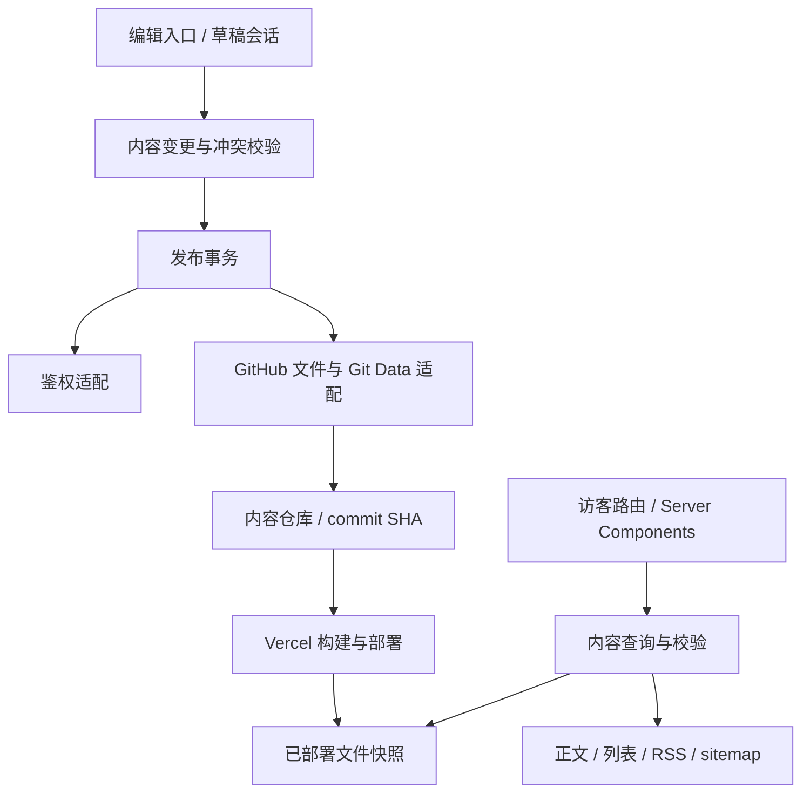

# 博客架构规划

日期：2026-10-27。状态：目标设计；当前已经落地的有界修复见 [Review 报告](REVIEW-2026-10-27.md)。本文中的新目录、接口、管理路由和迁移步骤尚未整体实施。

## 目标与核心决定

保留 Next.js App Router、React、Markdown、GitHub 内容仓库和 Vercel。把系统整理为**访客阅读、内容业务、发布事务、外部适配**四个有明确边界的部分。

1. Git 是持久内容源。文章配置、Markdown 和素材可审阅、可回溯；数据库不作为本阶段前提。
2. 已部署内容、编辑草稿、Git 提交、线上部署是四个独立事实，各有版本和成功条件。
3. 文章／项目／相册有明确数据契约，页面负责交互，基础服务负责 I/O，GitHub 适配器负责远端协议。
4. 访客页面优先服务端读取／预渲染。交互组件按需要使用客户端；写作预览保留客户端渲染。
5. 内容索引由文章元数据生成。正常迁移初期继续维护现有路径，先统一读写，再切换生成方式。

## 当前结构需要解决的具体混杂

| 当前情况 | 目标边界 |
| --- | --- |
| `src/app` 同时存路由、数据、业务服务、全局 store 与组件类型 | app 只做路由组合；功能模块拥有业务和类型；内容与持久化单独管理 |
| 文章配置与索引分别可写，分类曾只更新一处 | 同一份文章实体派生列表、RSS、sitemap；发布服务维护原子一致性 |
| 多个列表服务把页面上的整份 JSON 写回 | 编辑会话携带版本，发布服务提交领域变更；冲突不覆盖 |
| `github-client ↔ auth-store ↔ auth` 相互依赖，底层直接 toast | 纯协议客户端 → 鉴权／发布服务 → 状态／界面；toast 由界面订阅事件 |
| `isAuth` 同时代表本地材料存在和可操作 | 分别表达私钥材料、可用令牌、目标仓库权限和当前事务状态 |
| 静态内容、全局预览设置、已保存设置共用部分内存状态 | `published / draft / preview / confirmed` 各有归属，不以预览覆盖发布基线 |

## 目标调用关系



保存成功以 GitHub ref 的确认结果为准；部署完成以对应 commit 的部署结果为准。单纯等待一段时间或收到提交回执不能替代部署确认。

## 建议目录

```text
src/
  app/
    (site)/                     # 公开页面、元信息、loading/error/not-found
      page.tsx
      blog/[slug]/page.tsx
      projects/[slug]/page.tsx
      pictures/page.tsx
    (editor)/                   # 写作与集合管理入口，独立加载编辑代码
      write/...
    rss.xml/route.ts
    sitemap.ts
    layout.tsx
  features/
    blog/                       # 实体、校验、分类、阅读、编辑会话
      model/
      services/
      components/
    projects/                   # 目录条目、站内快照、演示三种职责
    gallery/                    # 照片组、上传、层叠视图、展开视图
    collections/                # 分享、收藏、随记；共用编辑机制，各自模型
    site-settings/              # 已发布配置、表单草稿、即时预览
    music/                      # 单 audio 实例和播放状态
    markdown/                   # parser、代码/数学、内容边界、展示组件
    publishing/                 # 发布用例、事务状态、确认回执
    auth/                       # 材料与会话生命周期、仓库权限
  infrastructure/
    content/                    # 现有目录的服务端文件读取、客户端读取适配
    github/                     # HTTP、Git Data、鉴权协议；不依赖 React/store
    storage/                    # 有版本、有 scope 的本地缓存
  shared/
    ui/                         # button、dialog、toast 展示等无业务组件
    lib/                        # 通用 URL、编码、日期；不放功能业务
  config/                       # 公开部署配置和静态默认值
  styles/
content/                        # 后续阶段的源内容目录；迁移时才建立
public/                         # 公开资源与生成输出
scripts/
  content/                      # 导入、校验、索引生成、受控提交材料
tests/
docs/
```

迁移时保留现有 `/blog/<slug>`、`/projects/<slug>`、图片 URL 及阅读记录键。`(site)`、`(editor)` 是不影响 URL 的路由组；现有 `/write` 可以保留。移动目录不是第一步，先建立数据契约与依赖边界。

依赖规则：app 可组合 features；features 可依赖领域契约和 infrastructure 的接口；infrastructure 不得反向导入 app、组件、Zustand 或 Sonner。UI 类型不能成为持久化格式的定义处。

## 数据与接口契约

### 文章

文章实体包括 slug、title、Markdown、tags、category、date、可选 cover、来源及时间字段。`slug` 是稳定身份，修改标题不修改路径。隐藏仅控制发现入口；真正的私密内容需从公开仓库／public 中分离并另设访问控制。

读取统一经过 `BlogRepository`，列表、详情、RSS、sitemap 使用相同校验、排序和公开过滤规则。来源笔记的原编写时间、更新时间和发布时刻分别保留；修改正文只更新相应内容版本，不用部署时间覆盖原编写时间。

建议的应用层形状：

```ts
type ContentSnapshot<T> = {
  value: T
  revision: string
}

interface BlogRepository {
  list(): Promise<ContentSnapshot<BlogSummary[]>>
  get(slug: string): Promise<ContentSnapshot<BlogDocument>>
}

type PublishResult = {
  commitSha: string
  confirmed: true
  deployment: 'not-checked' | 'pending' | 'ready' | 'failed'
}
```

发布入口接受 create/update/delete 命令及 baseRevision；同名 create 中止，update/delete 比较目标版本。图片、正文、配置、派生索引在同一提交中变化。格式错误、读取失败和空内容必须保持不同语义。

### 项目

明确两类目录条目：外部项目链接、具备本地 README/source 快照的站内项目。外链条目不生成站内详情。站内条目的 slug、目录、source revision、logo 和演示标识需要一起校验。

README 快照按固定 revision 解析资源，流程演示保持“说明工作路径”的定位。添加一个外部链接不应要求同步整个仓库；添加站内详情则必须先准备快照文件与元数据。

### 相册、分享、收藏与站点设置

条目使用稳定 ID，URL 作为可修改字段，上传 Map 不再以可变 URL 或数组位置标识对象。上传文件、预览地址和最终公开地址分别保存；发布结果返回规范化实体。

预览 URL 由创建它的编辑会话持有，在替换、取消、删除和离开时释放。删除素材前检查其他条目／文章的引用，不能仅比较一份相册列表。设置的“应用预览”更新 preview，刷新可恢复；保存回执更新 confirmed，草稿有后续修改时不能被旧回执清空。

## 发布事务与鉴权

推荐发布顺序：

1. 校验命令、目标路径和材料，取得编辑基线与当前远程版本。
2. 检查目标文件版本；有冲突保留草稿并返回冲突对象。
3. 固定一个 parent commit，所有读取都按这个 SHA。
4. 形成完整变更集，上传 blob，创建 tree/commit。
5. 非强制更新 ref。最终响应丢失时查证；未确认不自动重放。
6. 返回 commit SHA 与规范化结果。部署状态单独查询／显示。

同一编辑会话的同步门闩阻止重复动作；跨标签页仍依靠版本检查与非强制 ref 更新。读请求可有限重试；写请求不因超时自动重复提交。外部服务错误转成领域错误（未授权、冲突、格式不合法、结果未确认），界面负责展示恢复动作。

**鉴权迁移建议：**近期兼容现有本地 PEM 导入，但集中到独立 auth feature，避免让公开渲染入口携带编辑鉴权职责。令牌缓存保存 scope、expiresAt，限制到目标仓库和必要权限，过期按真实期限处理；凭据不写日志、草稿或业务 JSON。

长期网站管理入口可采用 GitHub 身份登录及服务端会话，由服务端持有 App 私钥、限定仓库和写入路径，浏览器使用短期会话；这会改变现有鉴权和部署契约，单独设计与实施。文章与资源也可通过 Git 工具链提交，沿用相同内容校验。浏览器 PEM 不是公开站点管理员身份的证明，页面上显示编辑按钮也不代表拥有 GitHub 写权限。

## 状态所有权

| 状态 | 唯一维护者 | 约束 |
| --- | --- | --- |
| 已部署文章／集合 | 内容读取层及只读查询缓存 | 不能被草稿直接写回 |
| 编辑基线、草稿、草稿 revision | 当前编辑会话 | 原始快照固定；不同 slug 的请求不能互相覆盖 |
| 图片文件、预览 URL、上传映射 | 媒体会话 | 用稳定 ID；离开／取消释放所有持有资源 |
| 格式有效的私钥、令牌及授权状态 | auth service/store | 格式通过、令牌可用、仓库授权分别表达 |
| 发布中、失败／未确认、commit 回执 | publishing service | 与读取 loading 分开；成功只确认本次 draft revision |
| 音源、播放请求、实际播放状态 | music feature | 单 audio；过时的 play 回调不能改变新曲目的状态 |
| 模态打开、焦点和滚动锁 | 通用 dialog／对应媒体 viewer | 多弹层时共享可计数锁，关闭不能错误恢复其他弹层的滚动状态 |
| 预览、已发布站点配置 | site-settings feature | 预览不等于已保存，也不成为远程 expectedVersion |

## 分步实施与验收

| 步骤 | 具体交付 | 必须保护的行为与停止条件 |
| --- | --- | --- |
| 0. 安全与写入基线 | 处理 Review R12–R15；优先安全依赖、全目标文件冲突保护、鉴权过期和异步资源生命周期 | 冻结安装、类型检查、内容及发布回归、生产构建通过；遇到框架／适配器兼容问题先保留当前锁文件与差异，不自动公开部署 |
| 1. 固定数据契约 | 将类型从 page/component 移到各 feature model；统一 schema、路径规则、时间语义及内容查询接口 | 204 篇已有文章、五个项目和现有素材身份／路径不变；错误数据不能变成空列表；导入基线与用户后续编辑的校验规则明确分开 |
| 2. 分离阅读与编辑 | 公开文章由 server repository 读取、生成 metadata、正确 notFound；客户端只负责必要交互；编辑代码独立加载 | 正文可从服务端 HTML 读取；不存在文章响应 404；音乐和相册交互保留；写作预览使用相同 Markdown 内容边界 |
| 3. 内容目录与索引生成 | 迁移源内容并建立单一索引生成器；更新导入／验证脚本与输出路径 | 迁移前后逐项比较 slug、正文、代码、配置和素材引用；改变源目录不改变公开 URL；原索引可回溯恢复 |
| 4. 统一编辑／发布会话 | 各集合使用 expectedVersion、规范化结果和草稿 revision；提交回执带 SHA；可选服务端鉴权方案独立接入 | 两个编辑者修改不能静默覆盖；超时不重复写入；旧回执不抹除新输入；有真实授权条件才做远端验证 |
| 5. 有依据地清理旧实现 | 移除已确认无入口的旧布局、旧设置兼容层、无调用的独立索引写入 API；整理 CSS 与部署适配依赖 | 先确认调用关系和数据读取已迁移；按功能删除，不同时改设计风格；保留有独立用途的辅助路由或明确归档 |

第一批架构实施应覆盖步骤 0–1，而不是先全量移动目录。每一步完成后保留一份可审阅的变更和验证结果，再进入下一步。本文规划不意味着这些重构、鉴权迁移或远程发布已经执行。
