### 大致版本内容
#### v1.3之前版本的标记清除法(mark and sweep)
#### v1.5三色标记法
#### v1.8混合洗屏障机制
## v1.3的标记清除法
GC : 垃圾回收.业务强少关注语言内存角度 ; C++没有标准库 ,golang 提供 ;

 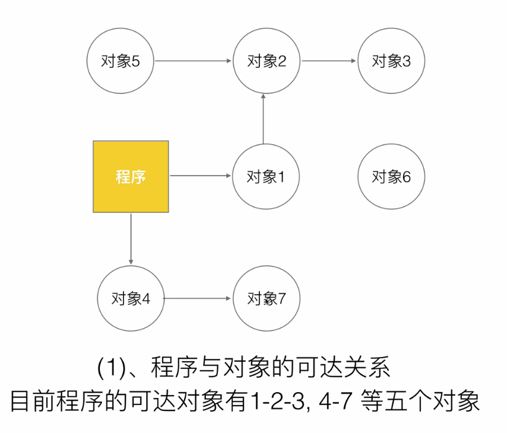

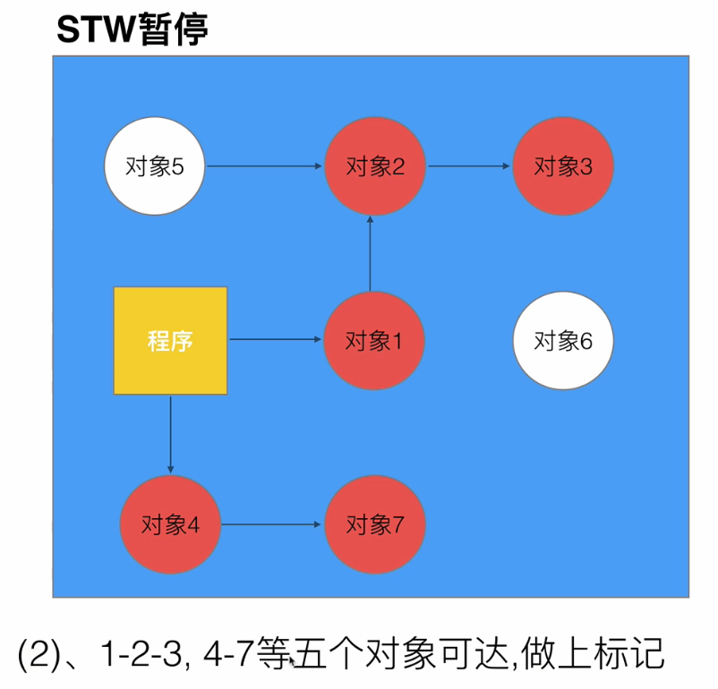

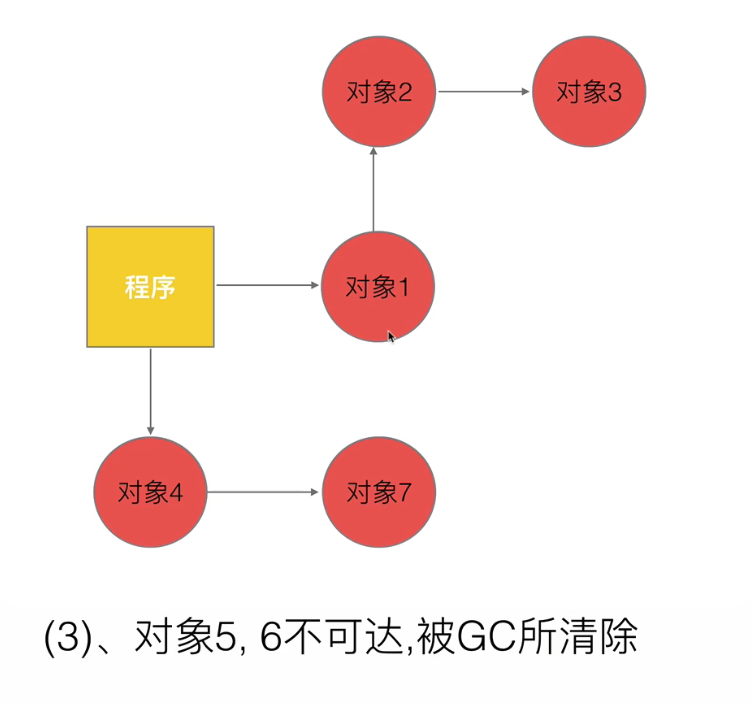

整个过程 :

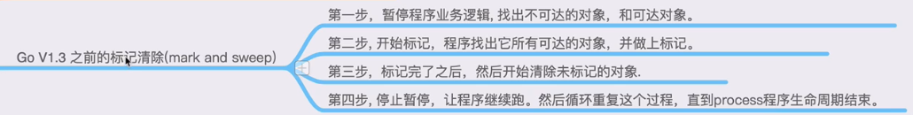

### v1.3标记清除的缺点
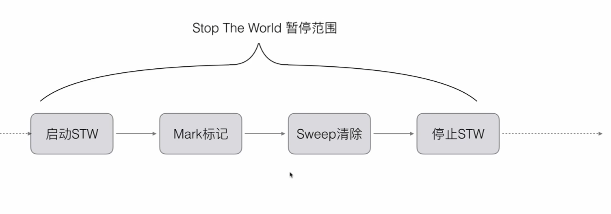

范围缩小一下, 可以缩小成前三个

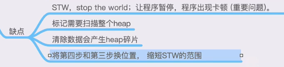

## V1.5三色标记法
White 白色标记表

Grey 灰色标记表

Black 黑色标记表

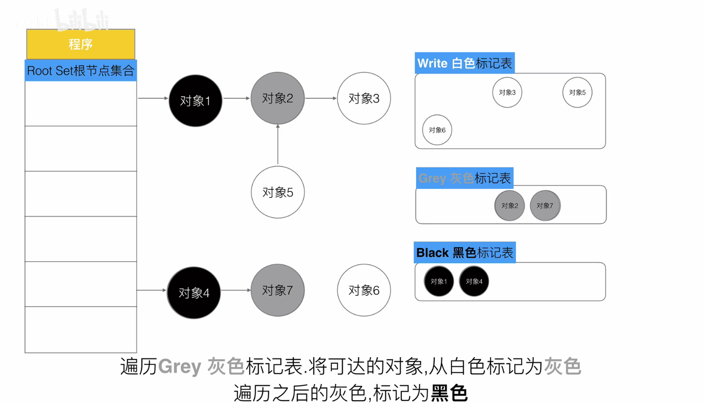

白色 : 只要是新创建的对象 , 当前没有实现遍历到的对象  ;  灰色 : 可以到达   ; 黑色  : 一定能到达 ;

第一步 : 全部的对象都是白色 ;

第二步 : GC开始 , 从根节点开始遍历 , 将白色对象的集合从白色放到灰色

第三步 : 开始遍历当前的灰色集合, 讲白->灰 , 灰 -> 黑 ;

之后知道当前的结构中只有黑色和白色的为止 , 最后回收全部的白色对象 ;

### 三色标记 与 STW
#### 如果没有 STW (stop the world)
万一在运行过程中 有 已经被列入黑色的对象a创建联系到白色对象的指针

 则无法实现扫描到(黑色已经不会扫描了) ;

两个条件同时满足的时候  一定会出现对象丢失的 现象 ;

### 强三色不变式
实现破坏条件1 : 强制性要求不允许 **黑色对象** 引用 **白色对象**

### 弱三色不变式
黑色对象可以引用白色对象 ;

破坏条件2 : 白色对象 存在 其他灰色对象 对它 的引用, 或者可达它的 链路上游 存在 黑色对象;

实现使用 **灰色保护** 的效果

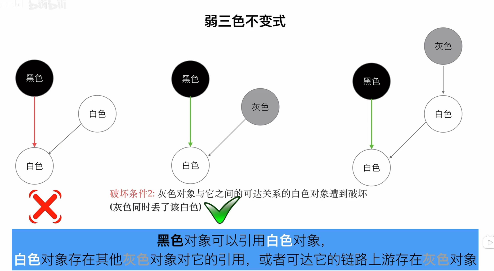

在三色标记种如果满足 强/弱 之一 , 既可以保证对象 不丢失 ;

### 屏障机制
### 背景：三色标记法中的“漏标”危机
现代GC常用**三色标记法**来追踪存活对象：

+ **白色**：尚未被标记的对象，GC结束时仍是白色就会被**回收**。
+ **灰色**：自身已被标记，但其引用的对象还未扫描，是**待处理**的中间状态。
+ **黑色**：自身及其所有引用都已被扫描完毕，是**安全**的存活对象。

如果GC和用户程序并发执行，用户程序可能会在GC扫描的过程中修改对象的引用，从而制造出“黑色对象直接引用白色对象”的情况。由于黑色对象不会被再次扫描，这个白色对象就可能被遗漏，最终被错误回收。

插入屏障和删除屏障，就是通过“写屏障”这种机制，在引用被修改时进行干预，来堵住这个漏洞。它们遵循两种不同的思路。

  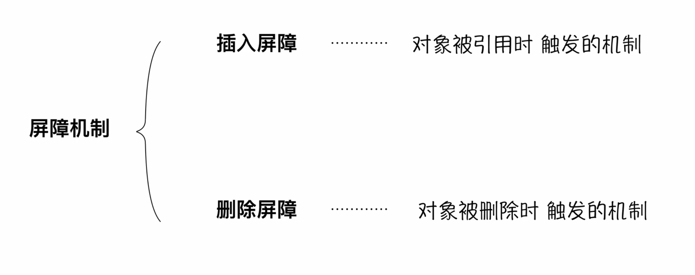

### 插入屏障
**核心规则**：当一个**黑色对象**尝试**插入**一个对**白色对象**的引用时，这个**白色对象**会被立即标记为**灰色**。

它遵循的是**强三色不变式**：**不允许黑色对象直接引用白色对象**。通过把新被引用的白色对象变灰，它就从“可能被遗漏”的名单，进入了“待扫描”的安全名单。

#### 例子：新引用的保护
假设GC扫描到一半，对象A已经是**黑色**（扫描完毕），对象B是**白色**（尚未访问）。

1. **没有屏障**：用户程序执行 `A.ref = B`。此时，A（黑）直接引用了B（白）。如果GC不再扫描A，B就会被漏掉并错误回收。
2. **有插入屏障**：写屏障会拦截这次赋值。在 `A.ref = B` 真正生效前，屏障逻辑发现“一个黑色对象正在引用一个白色对象”，于是**立即将B标记为灰色**。这样，B就进入了GC的待扫描队列，后续会被正常标记为黑色并保留下来。

**代价**：插入屏障有一个显著缺点。在许多实现（如早期的Go）中，为了性能，栈上的操作不经过写屏障。这意味着，如果一个栈上的对象引用了堆上的白色对象，这个引用关系不会被屏障捕获。因此，插入屏障方案通常需要在标记结束后，**专门暂停用户程序（STW）来重新扫描所有栈**，以确保没有遗漏，这会造成额外的停顿

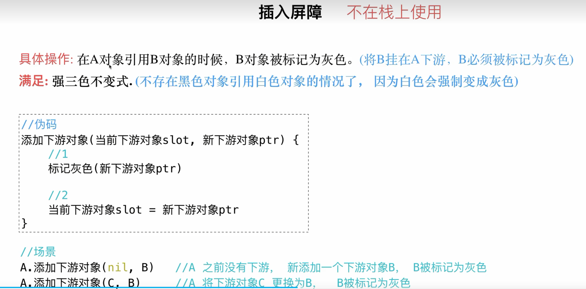

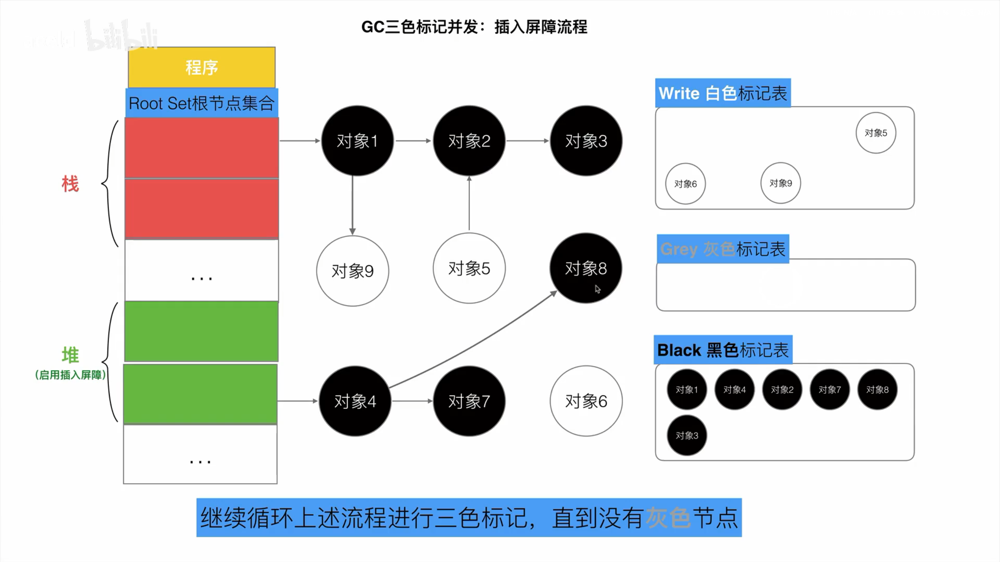

实现插入写屏障的不足 : 结束的时候需要实现 STW 实现重新扫描当前的栈, 需要延迟约(10 ~ 100 MS左右) ;

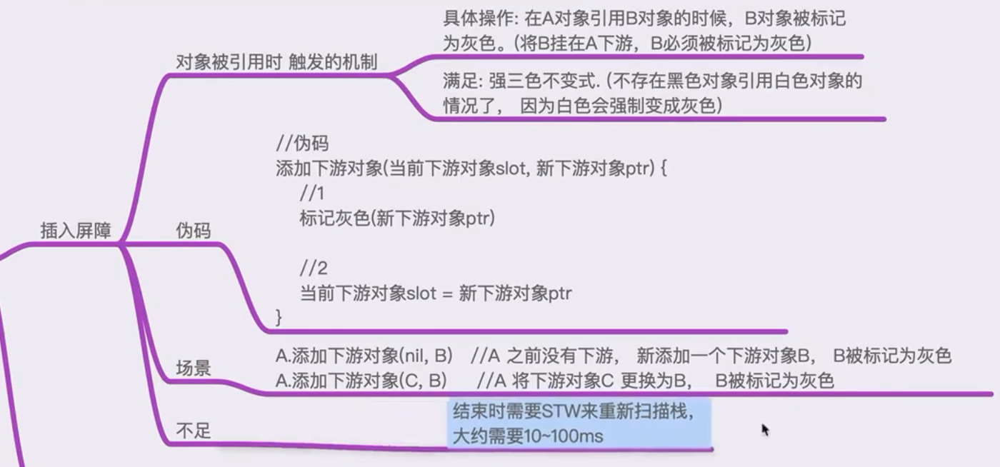

### 删除屏障
**核心规则**：当一个对象**删除**对另一个对象的引用时，**被删除引用的那个对象**会被标记为**灰色**。这种机制也叫 **SATB (Snapshot-At-The-Beginning)**，因为它相当于在GC开始时给所有可达对象拍了个快照，确保快照里活着的对象不会因为并发修改而“消失”。

它遵循的是**弱三色不变式**：**允许黑色引用白色，但必须保证这个白色对象通过其他路径（灰色对象）仍然可达**。删除屏障的思路是：一个对象即使被“切断”了一条引用路径，但只要它可能还通过其他路径存活，就把它先标记为灰色保护起来，避免它因为刚失去引用而被误判为垃圾。

#### 例子：被删除引用的保护
假设对象A（黑色）和对象C（灰色）都引用了对象B（白色）。这意味着B有两条存活路径。

1. **没有屏障**：用户程序执行 `A.ref = null`，删除了A对B的引用。此时，B只剩下C这一条灰色路径引用它，暂时还是安全的。但如果在GC扫描完C之后，用户又断开了C对B的引用，B就可能在无人察觉的情况下变成“孤岛”并被回收。
2. **有删除屏障**：当 `A.ref = null` 执行时，屏障会拦截并**将刚刚被删除引用的对象B标记为灰色**。这样，即使后续所有对B的引用都被断开，B因为已经被“染灰”而进入了待扫描队列，不会被漏掉。

**代价**：删除屏障的精度较低。如果一个对象B**确实已经死亡**，仅仅是碰巧在被删除引用时被屏障标记为灰色，那么它也会被强行“救活”，必须等到**下一轮GC**才能被回收。这会造成所谓“浮动垃圾”，降低内存回收的及时性。

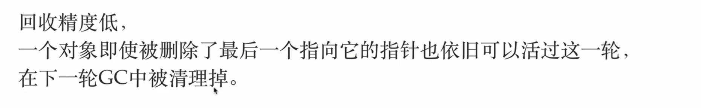

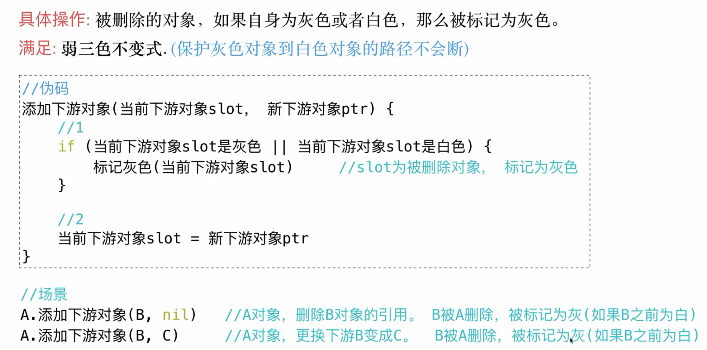

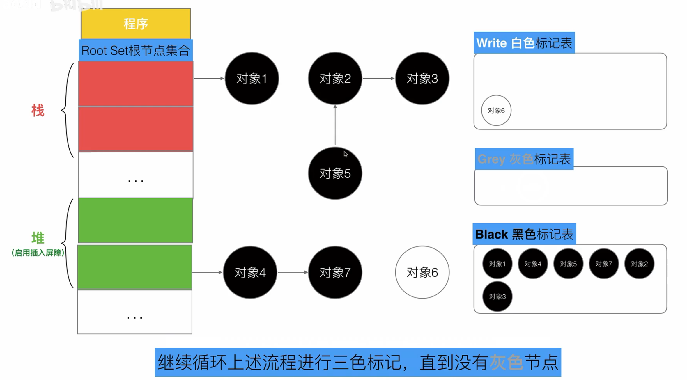

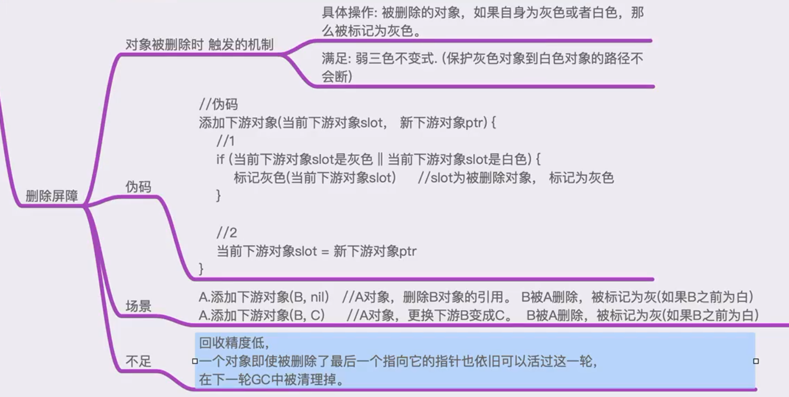

## V1.8混合洗屏障机制
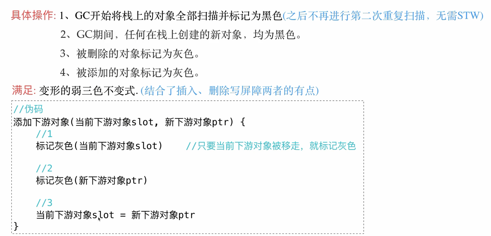

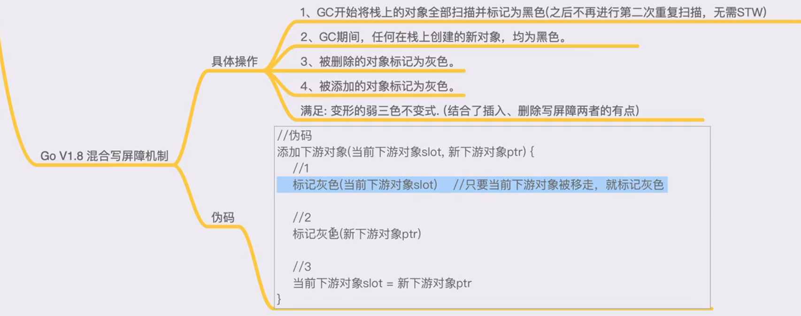

### 场景 :
#### 对象被堆对象删除引用, 成为栈对象的下游 (主要是屏障发力)
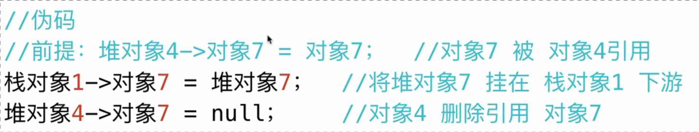

 栈对象不触发写屏障 引用 对象7 . 对象7 还要被 对象4 实现删除, 会触发写屏障 ;

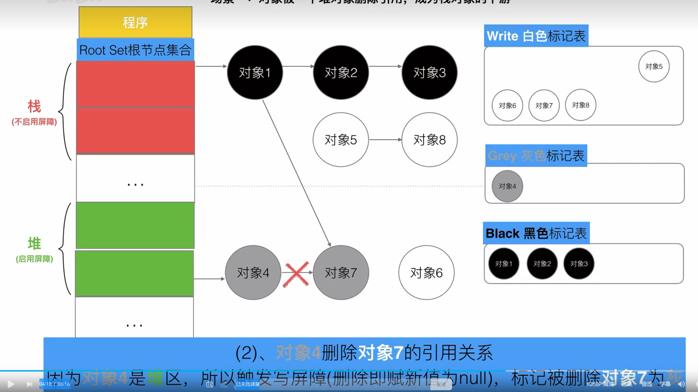

#### 2.对象被栈对象删除引用,成为另外一个栈对象引用(栈中对象全部为黑色发力)
对象在堆中创建天生就是黑色对象 ;

堆中 完全没有任何的 屏障过程 ;

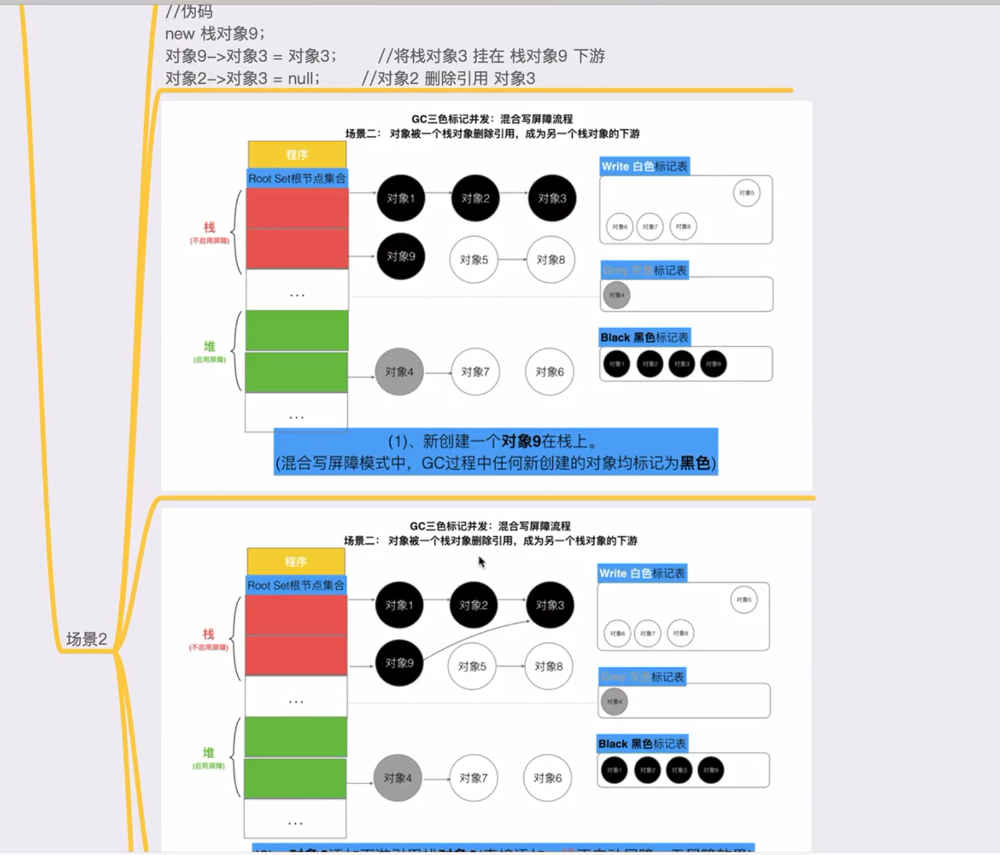

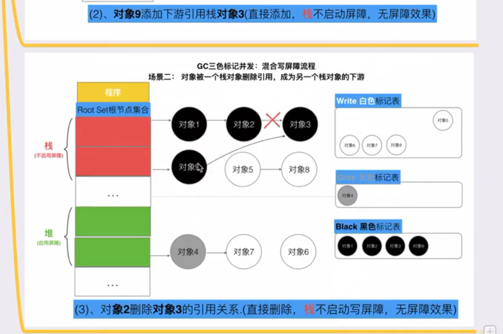

#### 3.对象被堆对象删除引用,成为另一个堆对象的下游 (还是堆中的对象会触发读写屏障发力)
会触发混合写屏障 : 新的被引用对象会被标记为 灰色  ;

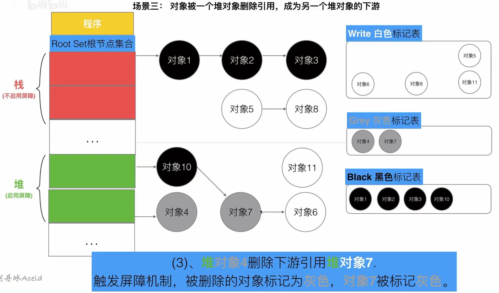

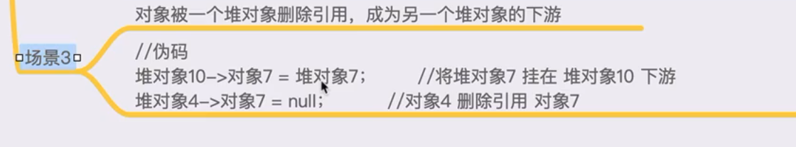

#### 4.对象被栈对象删除引用(原对象在栈),成为另一个堆对象的下游(读写屏障发力)
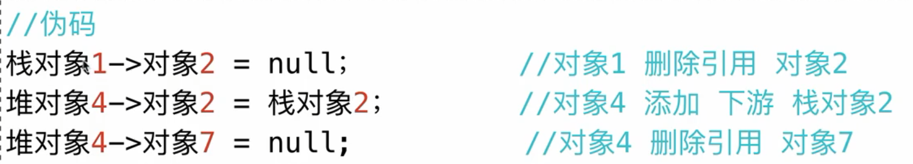

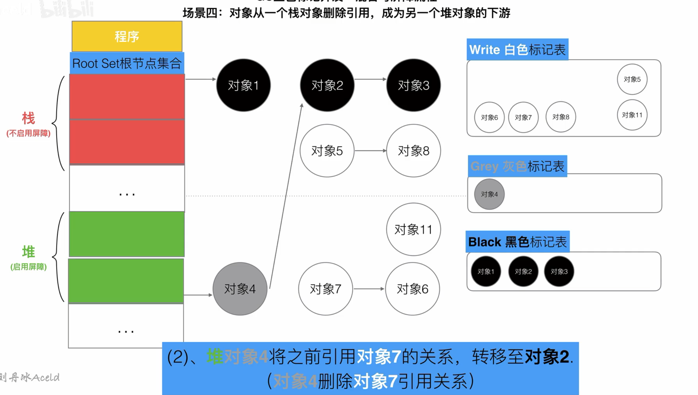

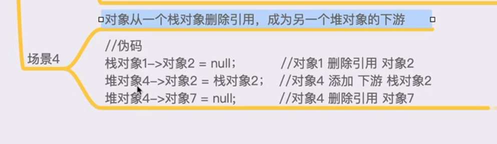

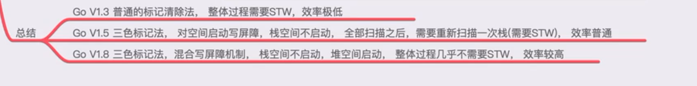

---

原文：[三色标记 · 语雀](https://www.yuque.com/17hwliao/ge2ibh/hwpnvyps8y0vgtvr)
